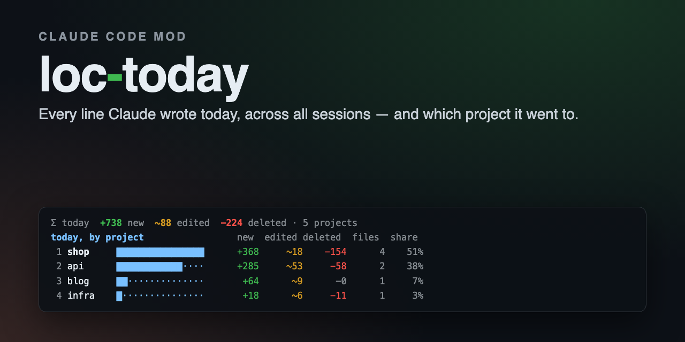
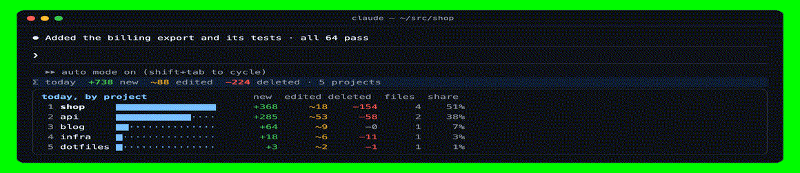
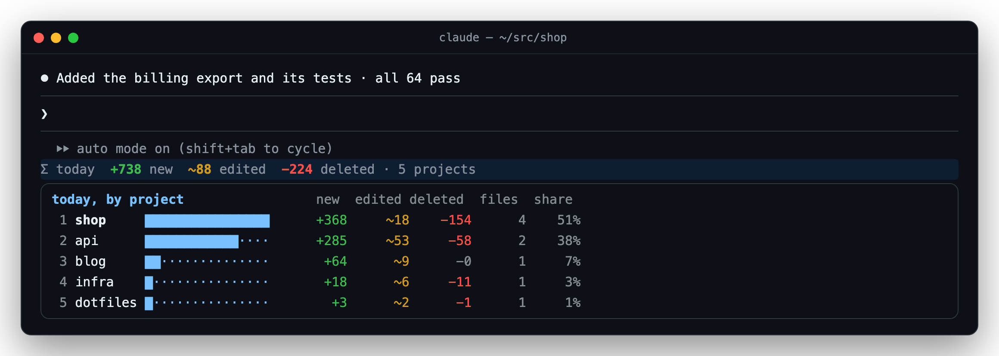
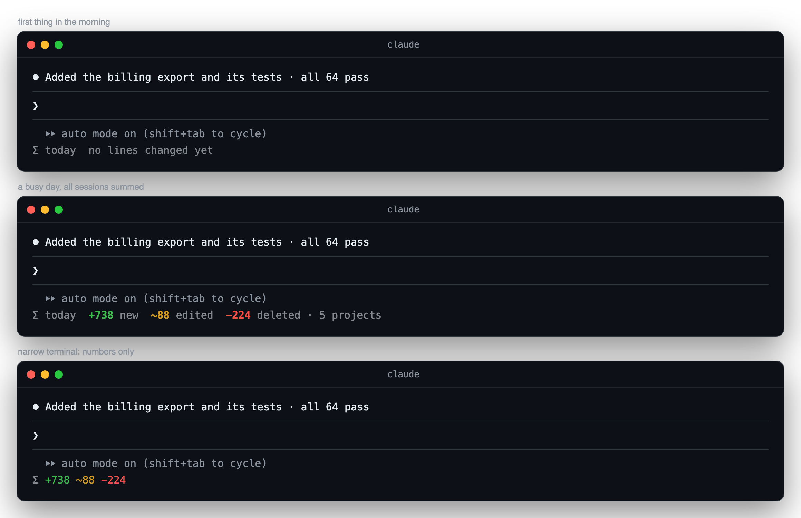

<div align="center">

<a href="https://github.com/pepperonas/loc-today"></a>

# 📈 loc-today

**A Claude Code mod that shows, right under the prompt, how many lines of code Claude created, edited and deleted today — summed over every session you have open, not just this one. Hover the line and it opens a ranking of your projects, largest first.**

<p>
  <a href="#-install"></a>
  &nbsp;
  <a href="#-demo"></a>
</p>

<h3>👉 <code>/plugin marketplace add pepperonas/loc-today</code> · <code>/plugin install loc-today@pepperonas-loc-today</code> — that's it.</h3>

[](CHANGELOG.md)
[](tests)
[](hooks)
[](hooks)

[](https://github.com/pepperonas/loc-today/actions/workflows/ci.yml)
[](https://code.claude.com/docs/en/plugins/mods/overview)
[](#requirements)
[](https://www.typescriptlang.org)
[](package.json)
[](package.json)
[](#-how-it-works)
[](#-privacy)
[](#-testing)
[](CHANGELOG.md)
[](https://semver.org)
[](https://github.com/pepperonas/loc-today/commits/main)
[](https://github.com/pepperonas/loc-today/issues)
[](https://github.com/pepperonas/loc-today)
[](https://github.com/pepperonas/loc-today/stargazers)
[](https://github.com/pepperonas/loc-today/forks)
[](#-contributing)
[](LICENSE)

[](https://www.paypal.com/donate/?business=martin.pfeffer@celox.io&currency_code=EUR&item_name=loc-today)
[](https://g.page/r/CXgdRV3QysvxEBM/review)

</div>

---

> [!NOTE]
> **Counted from Claude Code's own diffs.** An Edit or Write result carries the exact patch Claude Code
> applied; loc-today counts its `+` and `-` lines. Nothing is estimated from token counts, nothing
> leaves your machine.

## 🎬 Demo



<sub>Three sessions working at once — the line counts every one of them. Rest the pointer on it and the ranking opens: largest project first, with a bar, new / edited / deleted lines, files touched and its share of the day.</sub>

## 📸 Screenshots



<sub>Hovered: the day split by project, largest first.</sub>



<sub>First thing in the morning, a busy day, and a narrow terminal (below 80 columns the words go, the numbers stay).</sub>

## ✨ Features

- **Global, not per session** — every session writes its own figures for the day, and every line under every prompt shows the sum of all of them. Start a session in another project and it shows up within five seconds.
- **New, edited, deleted** — a removed line that is replaced by a new one is one **edited** line, not one deleted and one new one; what is left over is new or deleted. So renaming a variable on 3 lines is `~3`, not `+3 −3`.
- **Per project, ranked** — hover the line: the projects of the day, largest first, with a bar, the three counts, the files touched and the share of the day. Ten projects are listed, the rest summed in one line.
- **Projects found by git** — a file belongs to the git work tree it is in, wherever the session was started. Outside git, to the session's folder. Two projects with the same folder name are told apart by their parent.
- **Shell commands too** — `rm`, `sed -i`, `mv`, code generators: a Bash command is measured by the work tree before and after it (see [How it works](#-how-it-works)).
- **Only what really happened** — a failed or refused call counts nothing; a Write that only re-saved the same content counts nothing.
- **A new day at local midnight**, the last seven days kept, older ones cleaned up.

## 📥 Install

### Requirements

- **Claude Code with mods** — mods are on by default in current releases; loc-today is tested with **2.1.296**.
- **git** on your `PATH` (for finding projects and measuring shell commands). Nothing else: no account, no token, no network.
- The hover card needs a terminal that reports the mouse to Claude Code. The line itself and `/loc-today` work everywhere.

### Option 1 — marketplace (recommended)

The repository is its own plugin marketplace. In Claude Code:

```
/plugin marketplace add pepperonas/loc-today
/plugin install loc-today@pepperonas-loc-today
```

or from the shell:

```bash
claude plugin marketplace add pepperonas/loc-today
claude plugin install loc-today@pepperonas-loc-today
```

Counting starts with the next tool call of any session that has it loaded. Update with `/plugin marketplace update pepperonas-loc-today`, then `claude plugin update loc-today@pepperonas-loc-today`. Settings: `/plugin configure loc-today@pepperonas-loc-today` (every option has a default, so you can skip it).

### Option 2 — skills folder

Claude Code loads a plugin it finds in `~/.claude/skills/<name>` by itself, in every session:

```bash
git clone https://github.com/pepperonas/loc-today ~/.claude/skills/loc-today
```

Update with `git -C ~/.claude/skills/loc-today pull`. If you also install it from the marketplace, the marketplace copy wins.

### Option 3 — one session

```bash
git clone https://github.com/pepperonas/loc-today
claude --plugin-dir ./loc-today
```

### Option 4 — desktop app and SDK hosts

Where you can't pass a flag, name the folder in `CLAUDE_CODE_PLUGIN_DIRS` — in your shell environment or in the `env` block of `~/.claude/settings.json`:

```json
{ "env": { "CLAUDE_CODE_PLUGIN_DIRS": "~/src/loc-today" } }
```

## 🕹️ Usage

Nothing to do: the line appears under the prompt and counts as Claude works. The command shows the details and tunes it:

| Command | What it does |
| --- | --- |
| `/loc-today` | Today's totals and the full ranking of projects |
| `/loc-today full` | The whole line: numbers with words and the project count (default) |
| `/loc-today compact` | Numbers only |
| `/loc-today off` | No line; counting goes on, `/loc-today` still reports |
| `/loc-today reset` | Forget what **this** session counted today |
| `/loc-today reset all` | Forget what **every** session counted today |

The display setting is remembered across sessions.

## ⚙️ Configuration

`/plugin configure loc-today@pepperonas-loc-today` sets the default; the command above overrides it.

| Option | What it does | Default |
| --- | --- | --- |
| `mode` | `full`: the whole line · `compact`: numbers only · `off`: hidden | `full` |

## 🧠 How it works

**Where the numbers come from.** loc-today hooks `tool.call`, lets the tool run, and reads the result:

- **Edit / Write** — Claude Code hands back the `structuredPatch` it applied. Within each run of changed lines between context lines, removed and added lines are paired: `edited = min(−, +)`, the rest is `new` or `deleted`. A new file that comes without a patch counts its content as new lines.
- **Bash** — Claude Code does not hand a shell command's diff to mods (verified on 2.1.296: the field exists but stays empty). So loc-today measures it from outside: in the git work tree the session runs in, it records `git diff --numstat HEAD` and the untracked files **before** the command and again **after** it, and counts the difference. A file that disappears counts all its lines as deleted; a new untracked file counts its lines as new. Files an Edit or Write already counted while the command ran are skipped, so nothing is counted twice. A command that moves `HEAD` (a commit, checkout or reset) is not measured — what changed and what was merely committed can't be told apart then.

The git commands it runs, all read-only and without optional locks (`GIT_OPTIONAL_LOCKS=0`):

<!-- git-commands -->
```
git rev-parse --show-toplevel                 which project a file, and the session, belong to
git rev-parse HEAD                            before and after a Bash command: did HEAD move?
git diff --numstat --no-renames HEAD          before and after a Bash command: lines per tracked file
git ls-files --others --exclude-standard      before and after a Bash command: new untracked files
```
<!-- /git-commands -->

**How it is global.** Each session keeps its figures under its own key in the plugin's store, which every session of your account shares: `day:<date>:<session id>` → projects with created / edited / deleted lines and the files touched. A session writes **only its own key**, so two sessions writing at the same moment can never overwrite each other. Every five seconds (and right after its own changes) a session reads all of today's keys and sums them. The date is your local date (`date +%z`, read again every ten minutes, so it follows daylight saving). Keys older than seven days are removed when a session starts.

**What is drawn.** The line and the card are plain styled segments from `hooks/row.ts` under Claude Code's own prompt hint. The card is a Box that is hidden until the pointer is over the line — no hook runs on hover, nothing is fetched.

## 🔒 Privacy

- **No network.** The mod makes no request of any kind.
- **Stores counts and file paths only** — never file contents. The paths stay in Claude Code's local plugin store and are used to count distinct files.
- **Reads what it must:** the results of tool calls, the line count of new untracked files after a shell command, and the `git` output above.
- **Never in the way:** every hook falls back to the plain tool call on any error.

## 🧪 Testing

There are two suites, and the split is deliberate.

**Node suite** — `tests/*.spec.ts`, plain `node:test`, no Claude Code needed; this is what CI runs. It covers the counting rule (pure additions, pure removals, pairing within a run, runs split by context, several hunks, `\ No newline`), new files without a patch, overwrites, odd results, the numstat parser and the before/after delta (pre-existing uncommitted work not counted again, reverted lines counted as removed, a moved `HEAD` not measured, files another tool counted skipped), the local day across midnight and offsets, cleanup of old days, recording and summing two sessions without counting twice, ranking and ties, same-named folders, store values that don't fit, the line, the card (top ten + rest) and the report. Plus **drift guards** that hold this README to the code: the version everywhere, the test-count badges, every `/config` field and its default, every command, the git command list, every image, the marketplace entry and the install commands.

**Engine suite** — `hooks/*.test.tsx`, run by `claude plugin test .` against Claude Code's own engine: Edit, Write and Bash summed under the prompt with the engine's hint kept; the card ranks projects with their shares; another session's figures for today count and yesterday's don't, and this session writes only its own key; figures written later by another session appear on the next poll; a failed call counts nothing; narrow terminals; `off`, `full`, `reset` and `reset all`; old days cleaned up; Bash measured from the work tree; a Bash command that moves `HEAD` not measured.

**Every guarded behaviour is mutated once** — the bug put back, and the suite must go red. A test that has never been seen red is not an assurance.

It was also **verified live** on Claude Code 2.1.296: two sessions side by side, one writing a 5-line file and the other a 3-line file — both lines read `+8`; an edit showed `~1` in both; `rm` of a 6-line file and a new 2-line file in a git repository showed `−6` and `+2`; a simulated mouse move over the line opened the ranked card; a failed Edit counted nothing.

```bash
npm install              # dev tools only; the mod itself has no dependencies
npm test                 # node suite (CI)
claude plugin test .     # engine suite
claude plugin validate . # what the module hooks and calls
npm run screenshots      # re-render docs/ (needs `npx playwright install chromium` and ffmpeg)
```

## ❓ FAQ

**The numbers look low.** Only sessions that have loc-today loaded count, and only from the moment it was installed — the work before that today isn't in Claude Code's results any more. Shell commands are measured in the git work tree the session runs in; a command that changes files outside it, or outside git, isn't counted.

**Does it count what I type myself?** No — only what Claude changes through its tools. Your own edits in the editor are not tool calls.

**A Bash command ran while another session edited the same repository.** Then that session's edit can show up in this command's before/after difference too. It's rare, and it's the price of measuring shell commands from outside.

**Subagents?** Not verified yet. If Claude Code runs a subagent's tool calls through the mod's hooks, they are counted like any other; if not, they are missing. An issue with what you see is welcome.

**How do I start over?** `/loc-today reset` forgets this session's figures for today, `/loc-today reset all` everyone's. Other days are kept.

## 📝 Changelog

The full history is in [CHANGELOG.md](CHANGELOG.md) ([Keep a Changelog](https://keepachangelog.com/en/1.1.0/)).

- **0.1.0** — today's new, edited and deleted lines under the prompt, summed over all sessions, the ranked project card on hover, shell commands measured by git, `/loc-today`.

## 🤝 Contributing

Issues and pull requests are welcome. Please keep both suites green (`npm test`, `claude plugin test .`) and put the bug back once before you trust a new test. A change to a command, a setting, a git command or the version usually needs its counterpart in this README in the same PR — the drift guards will point at it.

## 💛 Support

loc-today is free and stays that way. If you like seeing the day add up:

- ⭐ **Star the repo** — it helps others find it.
- 💶 **[Donate with PayPal](https://www.paypal.com/donate/?business=martin.pfeffer@celox.io&currency_code=EUR&item_name=loc-today)** — keeps it maintained.
- 📝 **[Rate celox.io on Google](https://g.page/r/CXgdRV3QysvxEBM/review)** — helps just as much.

## 📄 License

MIT © 2026 **Martin Pfeffer** · [celox.io](https://celox.io). See [LICENSE](LICENSE).

loc-today is an independent community project and is not affiliated with or endorsed by Anthropic. *Claude* and *Claude Code* are trademarks of Anthropic, PBC.
